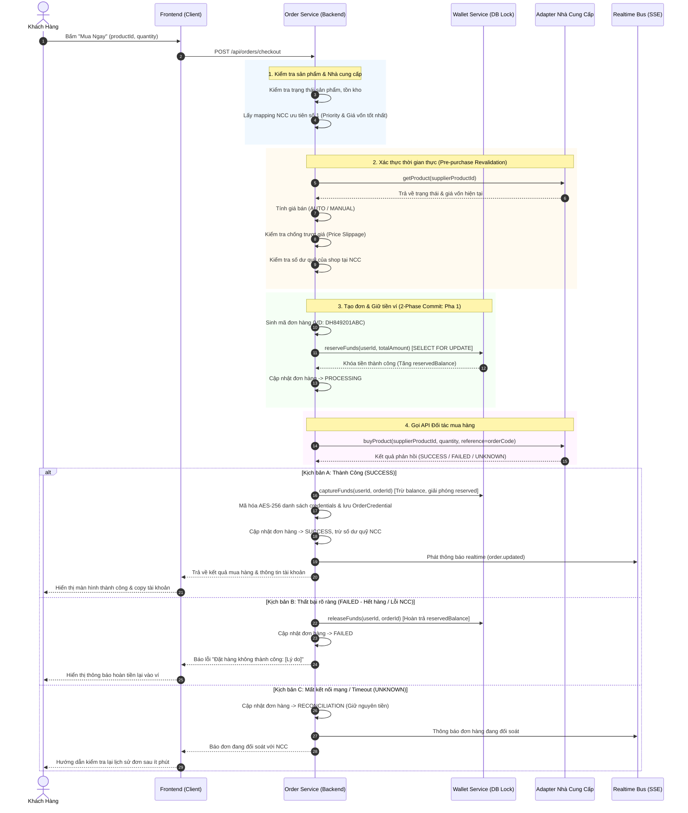

# Quy Trình Hoạt Động Khi Người Dùng Mua Hàng (Order & Purchase Flow)

Tài liệu này mô tả chi tiết toàn bộ luồng hoạt động từ lúc khách hàng nhấn **"Mua Ngay"** trên giao diện cho đến khi hệ thống tự động hoàn tất đơn hàng, bàn giao thông tin sản phẩm số và quyết toán tài chính.

---

## 1. Triết Lý Kiến Trúc Cốt Lõi

Hệ thống được thiết kế theo các nguyên tắc an toàn tài chính và tự động hóa cao cấp:
1. **Zero Double-Spending (Chống gian lận chi tiêu kép):** Dùng cơ chế khóa dòng database (`SELECT ... FOR UPDATE`) để ngăn khách hàng dùng cùng một số dư mua hàng ở 2 tab/thiết bị cùng một tích tắc.
2. **Two-Phase Commit (Cơ chế 2 pha Giữ tiền & Chốt tiền):** Không bao giờ trừ tiền ngay. Tiền chỉ được **Tạm giữ (Reserve)** trước khi gọi đối tác, và chỉ **Chốt trừ (Capture)** khi đối tác đã giao hàng thành công.
3. **Price Slippage Protection (Bảo vệ chống trượt giá):** Khi giá vốn bên nhà cung cấp (NCC) thay đổi đột ngột trước lúc bấm mua, hệ thống bắt buộc khách hàng xác nhận giá mới, tránh việc bị trừ nhiều tiền hơn mức nhìn thấy.
4. **Zero Data Plaintext (Mã hóa đầu cuối):** Toàn bộ thông tin tài khoản/bản quyền nhận từ nhà cung cấp đều được mã hóa bằng thuật toán `AES-256-GCM` trước khi lưu vào cơ sở dữ liệu.
5. **Reconciliation First (Đối soát an toàn khi mất kết nối):** Khi gọi NCC gặp Timeout hoặc sự cố mạng không rõ kết quả, hệ thống **không hoàn tiền ngay** và **không chốt trừ**, mà chuyển sang trạng thái đối soát an toàn (`RECONCILIATION`) để tránh thất thoát vốn.

---

## 2. Sơ Đồ Trình Tự Thực Thi (Sequence Diagram)



---

## 3. Chi Tiết 7 Giai Đoạn Vận Hành Khi Mua Hàng

### Giai Đoạn 1: Tiếp nhận yêu cầu mua hàng (Direct Checkout)
- **API Tiếp nhận:** `POST /api/orders/checkout`
- **Điều kiện tiên quyết:** Khách hàng phải có phiên đăng nhập hợp lệ (`requireApiUser`).
- **Tham số đầu vào:**
  - `productId`: ID sản phẩm nội bộ cần mua.
  - `quantity`: Số lượng muốn mua (giới hạn an toàn từ 1 đến 10 đơn vị mỗi lần mua).
  - `confirmedPrice` (tùy chọn): Mức giá niêm yết mà khách hàng nhìn thấy trước khi ấn nút.

### Giai Đoạn 2: Định tuyến nguồn hàng tối ưu (Supplier Sourcing)
- Hệ thống truy vấn sản phẩm trong DB kèm danh sách liên kết nhà cung cấp (`mappings`).
- Chỉ lọc các mapping đang bật (`isActive: true`) và nhà cung cấp có trạng thái `ACTIVE`.
- Sắp xếp tự động theo:
  1. `priority asc` (Độ ưu tiên do quản trị viên thiết lập).
  2. `supplierCost asc` (Giá vốn thấp nhất nếu cùng độ ưu tiên).
- Nếu không có nguồn nào hợp lệ, hệ thống báo lỗi ngay: *"Sản phẩm hiện tạm hết nguồn cung cấp khả dụng"*.

### Giai Đoạn 3: Xác thực giá & kiểm tra trượt giá (Pre-purchase Revalidation)
1. **Kiểm tra trạng thái thời gian thực:** Adapter gọi sang NCC (`adapter.getProduct`) để xác nhận sản phẩm bên NCC vẫn còn mở bán (`isActive === true`) và lấy giá vốn thực tế mới nhất.
2. **Tính toán giá bán:**
   - Nếu sản phẩm ở chế độ **AUTO**: Giá bán = Giá vốn NCC mới nhất + Biên lợi nhuận (cộng % hoặc cộng số tiền cố định).
   - Nếu sản phẩm ở chế độ **MANUAL**: Giữ nguyên mức giá cố định mà quản trị viên đã ghim.
3. **Chống trượt giá (Anti-Price Slippage):**
   - Nếu giá bán tính toán thời gian thực chênh lệch với mức giá mà khách vừa nhìn thấy (`expectedPrice !== unitSellingPrice`), hệ thống **dừng lại ngay lập tức** và trả về lỗi `409 Conflict`:
     ```json
     {
       "success": false,
       "error": "CONFLICT",
       "message": "Giá sản phẩm vừa thay đổi",
       "details": { "newPrice": "15000.00" }
     }
     ```
   - Frontend sẽ hiển thị thông báo popup: *"Giá sản phẩm vừa được cập nhật từ nhà cung cấp sang 15.000đ. Bạn có đồng ý tiếp tục mua không?"*. Khách hàng phải bấm đồng ý thì đơn hàng mới được tạo.
4. **Kiểm tra số dư quỹ NCC của hệ thống:**
   - Kiểm tra xem số dư tiền của shop tại tài khoản NCC (`SupplierBalance`) có đủ để chi trả `totalCost` hay không.
   - Nếu số dư không đủ, hệ thống chặn đơn và thông báo: *"Hệ thống đang bảo trì nguồn hàng, vui lòng thử lại sau ít phút"*, đồng thời kích hoạt cảnh báo số dư thấp cho quản trị viên nạp thêm tiền vào NCC.

### Giai Đoạn 4: Khóa tiền ví khách hàng (2-Phase Commit: Reservation)
1. Sinh mã đơn hàng duy nhất dạng: `DH` + 6 số thời gian + 3 ký tự ngẫu nhiên (Ví dụ: `DH284910KZ8`).
2. Tạo bản ghi đơn hàng trong cơ sở dữ liệu với trạng thái ban đầu là `PENDING`.
3. **Thực thi giữ tiền (Wallet Reservation):**
   - Mở một Transaction database độc lập với cơ chế khóa dòng:
     ```sql
     SELECT id FROM "Wallet" WHERE id = $walletId FOR UPDATE;
     ```
   - Tính toán số dư khả dụng: `availableBalance = balance - reservedBalance`.
   - Nếu `availableBalance < totalAmount`: Bắn lỗi `InsufficientFundsError` (*"Số dư ví không đủ. Cần X đ, hiện có Y đ"*).
   - Tạo bản ghi `WalletReservation` với trạng thái `RESERVED` và liên kết với `orderId`.
   - Cộng số tiền vào trường `reservedBalance` của ví.
   - Ghi một bản ghi lịch sử sổ cái ví (`WalletTransaction`) loại `RESERVATION`.
4. Cập nhật trạng thái đơn hàng sang `PROCESSING` (Đang gửi sang đối tác).

### Giai Đoạn 5: Gọi đối tác xuất hàng (Supplier Execution)
- Hệ thống gửi request sang nhà cung cấp tương ứng qua adapter đã được đăng ký (`QuangVinhAdapter`, `TapHoaMmoAdapter`, v.v.):
  - `supplierProductId`: Mã sản phẩm bên đối tác.
  - `quantity`: Số lượng.
  - `reference`: Truyền chính mã đơn hàng nội bộ (`orderCode`) làm Idempotency Key để đối tác không bao giờ xuất trùng hàng nếu bị gửi lại.
- Bộ phân tích phản hồi (`purchase-result.ts`) phân loại kết quả thành 1 trong 3 trạng thái:
  - `SUCCESS`: Đối tác đã nhận tiền và xuất danh sách tài khoản / mã code.
  - `FAILED`: Đối tác từ chối giao dịch (hết hàng, sản phẩm ngừng bán, lỗi tham số).
  - `UNKNOWN`: Mất kết nối, timeout mạng, HTTP 500, không thể biết chắc đối tác đã trừ tiền hay chưa.

---

## 4. Bảng Xử Lý Kết Quả & Trạng Thái Tài Chính

| Kịch Bản | Trạng Thái Đơn Hàng | Thao Tác Ví Khách Hàng | Thao Tác Dữ Liệu Bàn Giao | Quỹ Tiền Của Shop Tại NCC |
|---|---|---|---|---|
| **Thành Công (`SUCCESS`)** | `SUCCESS` | **Chốt trừ tiền (`captureFunds`):** Giảm `balance` thực tế, trừ giải tỏa `reservedBalance`. | Mã hóa `AES-256-GCM` từng dòng tài khoản/bản quyền, lưu vào bảng `OrderCredential`. | Trừ `totalCost` trong `SupplierBalance.balance`, tăng `totalSpent`. |
| **Thất Bại (`FAILED`)** | `FAILED` | **Hủy giữ tiền (`releaseFunds`):** Trả lại `reservedBalance` về số dư khả dụng ngay tức khắc. | Không lưu dữ liệu; ghi nhận chi tiết lỗi vào `errorDetails`. | Giữ nguyên, không thay đổi. |
| **Mất Mạng / Timeout (`UNKNOWN`)** | `RECONCILIATION` | **Giữ nguyên trạng thái khóa tiền:** Không trừ và không trả lại để tránh tổn thất kép. | Không lưu credential; chờ tiến trình đối soát tự động xử lý. | Đánh dấu đơn cần đối soát số dư. |

---

## 5. Bàn Giao Dữ Liệu Sản Phẩm Số Cho Khách Hàng

### Cơ chế mã hóa an toàn:
1. Khi đối tác trả về chuỗi tài khoản (ví dụ dạng `admin_vip|MatKhau123@#|2FA_CODE`):
   - Chuỗi này được mã hóa ngay lập tức bằng khóa bí mật `ENCRYPTION_SECRET`:
     ```typescript
     const encrypted = encryptData(rawCred);
     await prisma.orderCredential.create({
       data: { orderId, position, encryptedData: encrypted }
     });
     ```
   - Trong Database chỉ chứa chuỗi ký tự đã mã hóa, dù có lộ bản dump database cũng không bị lộ tài khoản của khách hàng.

### Xem và sử dụng tài khoản:
1. Khách hàng truy cập trang chi tiết đơn hàng: `/orders/[orderCode]`.
2. Hệ thống kiểm tra quyền sở hữu (`order.userId === currentUser.id`). Người dùng lạ hoặc chưa đăng nhập không thể xem được.
3. Hệ thống giải mã thời gian thực (`decryptData`), phân tách thành:
   - **Tên đăng nhập (Username / UID)**
   - **Mật khẩu (Password)**
   - **Mã khôi phục / 2FA / Cookie (nếu có)**
   - **Chuỗi đầy đủ (Raw)**
4. Giao diện cung cấp nút **"Sao chép nhanh" (1-Click Copy)** từng trường thông tin để khách hàng đăng nhập nhanh chóng.

---

## 6. Các Tình Huống Ngoại Lệ & Cơ Chế Ứng Phó (Edge Cases)

### 1. Khách hàng mở 10 tab bấm mua cùng lúc (Race Condition)
- **Rủi ro:** Ví chỉ có 10.000đ nhưng bấm mua 5 món hàng 10.000đ cùng lúc khiến ví bị âm 40.000đ.
- **Giải pháp:** Cơ chế `lockWallet` với lệnh SQL `SELECT ... FOR UPDATE` buộc mọi yêu cầu phải xếp hàng tuần tự. Yêu cầu đầu tiên giữ 10.000đ thành công; 4 yêu cầu sau khi được mở khóa kiểm tra thấy `availableBalance = 0đ` và sẽ bị từ chối ngay lập tức.

### 2. Nhà cung cấp tăng giá đúng lúc bấm mua
- **Rủi ro:** Khách nhìn thấy giá 10.000đ, nhưng bên NCC vừa tăng giá vốn lên 20.000đ khiến giá bán tự động nhảy lên 23.000đ.
- **Giải pháp:** Cơ chế so khớp `confirmedPrice` sẽ chặn giao dịch trước khi tạo đơn và yêu cầu khách hàng xác nhận biểu giá mới.

### 3. Đứt cáp quang / Timeout khi đang gọi nhà cung cấp
- **Rủi ro:** Shop đã gửi lệnh mua sang NCC, NCC đã trừ tiền của shop và tạo tài khoản, nhưng đường truyền về bị đứt. Nếu hệ thống tự động hoàn tiền cho khách, khách vừa nhận lại tiền trong ví, vừa có thể lấy tài khoản bên NCC => Shop mất trắng tiền vốn.
- **Giải pháp:** Hệ thống đưa đơn hàng vào trạng thái `RECONCILIATION`. Số tiền trong ví khách hàng vẫn được giữ nguyên. Sau đó, tiến trình đối soát (Reconciliation Job) hoặc quản trị viên kiểm tra mã giao dịch bên NCC:
  - Nếu NCC xác nhận đã thành công: Chốt trừ tiền và lấy tài khoản về cho khách.
  - Nếu NCC xác nhận chưa khớp đơn: Giải phóng tiền trả lại ví cho khách hàng.

---

## 7. Các File Nguồn Tham Chiếu Chính

- **Xử lý toàn bộ logic đơn hàng:** [src/lib/services/order.service.ts](file:///Users/minhdinh/Documents/MinhDinh/ZIM/Zimbabwe_ty_do/src/lib/services/order.service.ts)
- **Quản lý ví & khóa dòng 2 pha:** [src/lib/wallet/wallet.service.ts](file:///Users/minhdinh/Documents/MinhDinh/ZIM/Zimbabwe_ty_do/src/lib/wallet/wallet.service.ts)
- **Bộ chuẩn hóa phản hồi mua hàng NCC:** [src/lib/suppliers/purchase-result.ts](file:///Users/minhdinh/Documents/MinhDinh/ZIM/Zimbabwe_ty_do/src/lib/suppliers/purchase-result.ts)
- **Công thức tính giá & lợi nhuận:** [src/lib/utils/money.ts](file:///Users/minhdinh/Documents/MinhDinh/ZIM/Zimbabwe_ty_do/src/lib/utils/money.ts)
- **Mã hóa & bảo mật dữ liệu bàn giao:** [src/lib/utils/crypto.ts](file:///Users/minhdinh/Documents/MinhDinh/ZIM/Zimbabwe_ty_do/src/lib/utils/crypto.ts)
- **API Checkout:** [src/app/api/orders/checkout/route.ts](file:///Users/minhdinh/Documents/MinhDinh/ZIM/Zimbabwe_ty_do/src/app/api/orders/checkout/route.ts)
